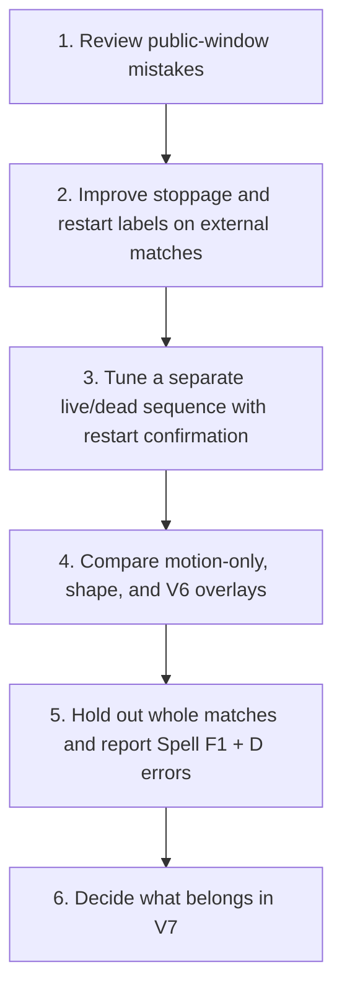

# FirstTrial: repeatable possession experiments

This folder keeps our experiments together, from the first nearest-player baseline through team shape, stoppage clues, physics, HMM smoothing, abstention, and external-sample training. The highest observed **custom-method** Spell F1 on the public five minutes remains **0.4118**, reached by V7 confirmed control and tied by V8's ball-based variants. The supplied **smooth125 baseline scores 0.4242 on this same public sample**, although the official full-match results favor smooth50 over smooth125. V8 adds nine correct dead-ball frames and one false dead-ball frame, raising frame accuracy from 70.80% to 70.91%, but does not improve Spell F1. The reused sample has only 17 possession spells; it cannot establish a full-match winner. V9 therefore selects methods on a larger external bench (1,145 possession spells from three Metrica matches, with the ball hidden during live play to resemble BAR-ATH); see the V9 section. See the V7/V8 sections below for comparisons and limitations. Earlier sections record the experiments as they stood at the time.

## Run it

Use Python 3.11 or newer. From the repository folder in PowerShell:

```powershell
python -m venv .venv
.\.venv\Scripts\python.exe -m pip install -r requirements-first-trial.txt
.\.venv\Scripts\python.exe -m unittest discover -s tests -v
.\.venv\Scripts\python.exe -m solution.run
```

The tactical ATD XML and TXT must be in `data/tactical/`. Alternatively use `--data-dir PATH`, where PATH contains the `tactical/` folder. Run `python -m solution.run --help` with the same environment for other options.

The first run writes predictions for all 199,319 frames, checks the official submission format, and scores the completed predictions against the public five-minute example. It writes everything under `data/runs/first_trial/`, which Git ignores.

Open `data/runs/first_trial/comparison.html` for the score table and possession timeline. Each method has a CSV under `predictions/` and a frame-by-frame explanation under `diagnostics/`. `manifest.json` records settings, package versions, and input/code/output hashes.

To generate another set without reading answer labels:

```powershell
.\.venv\Scripts\python.exe -m solution.run --out data/runs/first_trial_repeat --skip-score
```

## What we already have

| Input | Used now? | Purpose |
|---|---|---|
| Tactical ATD TXT | Yes | Ball/player positions and provided speeds, frame by frame |
| Tactical ATD XML | Yes | Team assignment of each tracking slot and frame rate |
| Published match metadata in `games.py` | Yes | Pitch dimensions, 25 fps, frame count, and half boundaries |
| Public possession labels | Evaluation only | Check the finished predictions on five minutes |
| Tactical homography | No | Relates pitch positions to video pixels; useful for visual checks |
| Tactical Smart Tagging | No | Possible event clues for a later experiment |
| Broadcast tracking/homography | No | Needs time alignment before it can supplement tactical data |
| Match video | No | Useful for reviewing mistakes; not required for this run |

The supplied track slots are anonymous track fragments. They are not 22 permanent player identities. Version 1 therefore uses team-level distances and robust speed summaries. It does not calculate named-player acceleration or guess identities.

## Four fixed comparisons

| Method | Main idea |
|---|---|
| `reference_smooth50` | Reproduce the official nearest-player baseline with its published smoothing |
| `gap_sequence` | Use clear nearby-team evidence; choose a sequence that penalizes rapid switches and carries evidence across missing observations |
| `gap_stop_sequence` | Add sustained out-of-bounds, stationary-ball-plus-slow-play, and slow-play-plus-long-gap clues |
| `gap_stop_sequence_x` | Replace only short internal missing-ball gaps with X when their surrounding decoded team is the same |

H = Barcelona, A = Athletic Club, D = dead/out of play, X = abstain. Missing ball data does not automatically mean D. Slow movement alone does not mean D. These stoppage clues are hypotheses that can be wrong, not confirmed fouls, cards, substitutions, or goals.

The sequence model uses minimum-cost decoding (Viterbi). A nearby team receives a lower cost; changing team incurs an extra cost. The costs are rules, not trained probabilities. Each half is decoded independently. Frames outside the published halves are X in our three methods. The reference is reproduced exactly.

X is an output policy, not a fourth possession state. For spell scoring the official evaluator fills X from previous non-X labels within its scoring blocks, including D; it also backfills leading X. Per-frame macro F1 counts a graded X as a miss. Adding X to an already smooth same-team gap therefore should not improve spell F1 and may reduce macro F1. We keep this comparison to measure that tradeoff explicitly.

## Where to change our code

| File | Responsibility |
|---|---|
| `config.json` | Declared distance, timing, speed, and switching settings |
| `data.py` | Strict streaming ATD reader; normalized coordinates converted to metres |
| `features.py` | Ball gaps, coverage, ball jumps, and potential stoppage clues |
| `predict.py` | Team evidence, sequence decoding, and optional X policy |
| `run.py` | Repeatable experiment, format checks, hashes, and official scorer invocation |
| `report.py` | Local score table and timeline, built after prediction is finished |
| `../tests/test_first_trial.py` | Checks using invented tracking examples |

Our implementation lives in `solution/`. The official starter, scorer, public labels, match configuration, and published baseline files stay unchanged. All supplied data and generated outputs stay in ignored `data/`. No command here commits or pushes.

## How to judge the result

1. Confirm frame alignment and valid output before comparing scores.
2. Compare all four results, including worse ones. The main metric is spell F1; macro F1 measures a different aspect.
3. Inspect the timeline and explanation files to find false stoppages, extra switches, and uncertain turnover times.
4. Review a few difficult clips if video is available and the challenge permits that use. Do not enter label-derived corrections into prediction code.
5. Improve one idea at a time and keep its result. Avoid repeatedly tuning against the same public five minutes.
6. Before broad model selection, obtain permitted additional labels or a separate validation period. Use time blocks or whole possessions, not randomly mixed neighboring frames.

Later comparisons could include a tree model with time context and a sequence decoder, or a temporal model if enough labels become available. Trying every model on this tiny sample would mostly test which one fits the example. Better evidence and validation come first.

Initial settings are engineering choices, not calibrated thresholds. Future observations are used, so this is an offline experiment. Timing of a turnover inside a fully missing interval remains uncertain. A slow missing-ball period can still be live play, and this may produce a false D. Scores on five minutes do not establish performance across the full match.

## Second experiment: team shape and movement

The first example and its aggregate scores are preserved in commit `7151778` and `results/first_trial_v1.json`. Run the second comparison with:

```powershell
.\.venv\Scripts\python.exe -m solution.run_v2
```

It also needs `data/tactical/BAR-ATH_tactical_smart_tagging.xml`. Outputs go to the separate ignored folder `data/runs/second_trial/`, leaving the first run intact. Use `--skip-score --out data/runs/second_trial_repeat` for a prediction-only repeat. The first experiment's command and settings still work.

| New feature | How we use it | Limitation |
|---|---|---|
| Team hull area | Area covered by each team's detected positions | Includes the goalkeeper and depends on tracking coverage |
| Team width, length, center, spread | Describe whether a team stretches or contracts | A wide shape does not automatically mean possession |
| Smoothed velocity | Position change over 0.04 seconds, smoothed over five velocity samples | Only a short continuous track fragment is trusted |
| Acceleration and braking | Changes in smoothed speed; fractions of tracks above/below burst thresholds | Undetected identity changes and noise remain possible |
| Movement toward a common area | Count tracks from both sides approaching a short-gap ball estimate | This can indicate a press or duel, not necessarily the owner |
| Automatic phase tags | Small possession priors from attacking/defending phases | These are automatic annotations, not manual confirmed events |

`context.py` computes these features and weak team prototypes. We learn what each team's shape/movement looks like from clear visible-ball proximity examples in that same half. Those proxy labels can be wrong. We sample at one frame per second and require enough examples from both teams for each feature; otherwise that feature contributes nothing. This is a small fitted classifier using noisy tracking-derived labels, not supervised training on the public answers.

`config_v2.json` declares the new settings before scoring. The six comparisons are the official baseline, the unchanged v1 approach, shape only, motion only, shape plus motion, and shape plus motion plus automatic tags. Extra clues are weak costs inside the same sequence decoder, not hard team overrides. The public possession labels are read only after all predictions and hashes are written.

Geometry removes very close duplicate detections and requires enough tracks from both teams. Movement resets at missing samples, implausible speed jumps, and half boundaries. A slot can still change identity without an obvious jump, so no named-player acceleration or role is claimed. Ball interpolation covers only short internal gaps with usable observations on both sides, plausible endpoint travel speed, and no confirmed stoppage clue. It does not recover the actual ball path.

Defending tags name the defending team, so their possession prior is inverted. Conflicting team votes cancel. Unknown teams, set-piece intervals, and goal intervals are excluded from team priors. We do not invent a manual foul/card/substitution log, and we do not label a whole restart interval D. The basic stoppage rules remain unchanged so we can measure the new team features separately.

The HTML report now includes percentage frame accuracy as well as F1 scores. `diagnostics/context_features.csv` records the collective features and costs locally. The second comparison reuses the same public sample seen in v1: it is exploratory evidence, not an independent validation result. Broadcast fusion, video review, named-player roles, and reliable event-based stoppage timing remain future work.

### Measured result on the public five minutes

| Method | Frame accuracy | Spell F1 | Macro F1 |
|---|---:|---:|---:|
| Official reference | 71.32% | 0.3256 | 0.6207 |
| V1 with stoppage clues | 71.20% | 0.3238 | 0.5642 |
| V2 shape | 73.61% | 0.3273 | 0.5806 |
| V2 movement | 69.28% | 0.3289 | 0.5475 |
| V2 shape + movement | 73.63% | 0.3273 | 0.5807 |
| V2 shape + movement + automatic tags | 71.71% | 0.2800 | 0.5688 |

Shape accounts for nearly all the observed frame-accuracy gain. Adding movement to shape gets only one extra frame correct out of 7,500; that is not evidence that the combination is better. The movement-only variant has the highest observed spell F1, while its frame accuracy is worse. Automatic tags produce more possession switches and a lower spell score in this implementation.

The official evaluator's 1,000-draw bootstrap gives broad overlapping spell-score ranges: approximately 0.209–0.455 for shape plus movement, 0.200–0.448 for v1, and 0.214–0.447 for the reference. These are not independent validation results or proof of a full-match improvement. Missed stoppages remain a major weakness, and the reference still has the highest macro F1.

All 31 behavior checks passed. A complete prediction-only repeat produced identical bytes and matching hashes for all six methods. The v1 and reference predictions also match their original files exactly. The local `reproducibility.json` and `uncertainty/scoreboard.csv` preserve those checks. V2 code is on `FirstTrial`; generated match outputs remain local.

## Third experiment: dead-ball candidates and spell duration

Run the fixed v3 comparison with:

```powershell
.\.venv\Scripts\python.exe -m solution.run_v3
```

It uses the tactical ATD and automatic Smart Tagging files. It adds two hypotheses: sustained low movement plus a stationary or missing ball can mark a dead-ball candidate, and minimum-duration decoding can prevent very short state changes. Set-piece tags only support a candidate when the tracking clues also agree. Each candidate is tested as a soft cost or a forced `D`, with and without the minimum-duration decoder. No public answer labels are read until every prediction has been written and hashed.

| Method | Frame accuracy | Spell F1 | Macro F1 | Predicted possessions |
|---|---:|---:|---:|---:|
| Official reference | 71.32% | 0.3256 | 0.6207 | 26 |
| V2 shape | 73.61% | 0.3273 | 0.5806 | 27 |
| V2 shape + movement | 73.63% | 0.3273 | 0.5807 | 27 |
| V3 soft dead-ball cost | 80.80% | 0.2979 | 0.7644 | 30 |
| V3 soft cost + duration | 80.75% | 0.2979 | 0.7638 | 30 |
| V3 forced dead-ball label | 81.96% | 0.2857 | 0.7926 | 32 |
| V3 forced label + duration | 81.95% | 0.2857 | 0.7925 | 32 |
| V3 soft cost + set-piece support | 80.72% | 0.3083 | 0.7635 | 31 |
| V3 soft + set-piece + duration | 80.61% | 0.3083 | 0.7624 | 31 |
| V3 forced label + set-piece support | 81.45% | 0.2745 | 0.7867 | 34 |
| V3 forced + set-piece + duration | 81.44% | 0.2745 | 0.7866 | 34 |

The highest v3 spell score is still below the V2 motion-only result and the official reference. Every result uses the same small public example of 17 possessions. The 90% spell-score bootstrap ranges overlap broadly, so this run does not show that any one version is the full-match winner.

The new stoppage rules raised dead-ball recall from 7.3% in v2 shape plus movement to 45.3% with soft costs and 58.3% with forced labels. Forced labels also reduced dead-ball precision from 96.9% to 87.3%. The v3 variants predicted 30–34 possessions, compared with 17 in the answer, which points to extra breaks or team switches. This improves dead-ball frame detection while hurting possession-spell agreement.

The tested duration limits were 0.32 seconds for team states and 0.40 seconds for dead-ball states. They changed only 1–8 of the 7,500 graded frames and did not change spell F1 or the possession count. These settings add little beyond the existing sequence smoothing. Automatic set-piece support slightly raised the soft version's spell score, but it stayed below the reference and its bootstrap range overlaps the other methods.

All 40 behavior checks passed. A prediction-only repeat produced identical bytes for all 11 methods, and the v2 shape, v2 shape plus movement, and official reference outputs exactly match their saved versions. Full outputs, frame diagnostics, and the comparison page are in ignored `data/runs/third_trial/`; the safe aggregate score export is `results/first_trial_v3.json`. V3 is on `FirstTrial` in commit `90544bd`; generated match outputs remain local.

## Fourth experiment: player reach physics and an HMM

Install the added HMM dependency and run V4 with:

```powershell
.\.venv\Scripts\python.exe -m pip install -r requirements-v4.txt
.\.venv\Scripts\python.exe -m solution.run_v4
```

V4 tests two ideas: **who could reach the ball soonest?** and **can a Hidden Markov Model (HMM) smooth frame-by-frame evidence?** It compares seven fixed methods, including the official reference, V2, and V3 results. It does not fit model settings to the public answer labels.

### Physics reach estimate

For each tracked player, the model uses their current position and smoothed movement direction. It lets them continue for a 0.7 second reaction time, then accelerate toward the ball at up to 7 m/s² until a 5 m/s cap. A logistic curve turns estimated arrival time into a chance of reaching the target within 1 second. Individual player chances are combined into relative Barcelona/Athletic reach scores, which enter the possession decoder only as a weak extra cost.

This is **inspired by Spearman's pitch-control model**, not a full reproduction. The current version leaves out ball-flight drag and trajectory choice, offside, individual player attributes, and full pitch-control integration. It also needs a ball coordinate to calculate reach. The tracking file had ball coordinates on 56.9% of frames; safe interpolation filled only 41 additional missing-ball frames. So this version cannot resolve the long gaps that make up most hard cases.

### HMM smoother

The HMM reads the raw Home/Away/Dead cost winner and its confidence level. Its states are H, A, and D. The transition settings favor staying in the same state, and the emission settings describe how much to trust strong or weak observations. We set those values by hand; we did not train them on the 17 public possession spells. Each half is decoded separately. In this run, the HMM made more switches than the V2 sequence decoder.

### Measured result on the public five minutes

| Method | Frame accuracy | Spell F1 | 5th–95th percentile range | Predicted possessions |
|---|---:|---:|---:|---:|
| Official reference | 71.32% | 0.3256 | 0.214–0.447 | 26 |
| V2 motion only | 69.28% | **0.3289** | 0.213–0.436 | 28 |
| V2 shape + movement | 73.63% | 0.3273 | 0.209–0.455 | 27 |
| V3 soft cost + set-piece support | 80.72% | 0.3083 | 0.200–0.417 | 31 |
| V4 pitch-control reach | 69.33% | 0.1517 | 0.097–0.214 | 41 |
| V4 HMM | 73.24% | 0.1949 | 0.123–0.267 | 61 |
| V4 pitch control + HMM | 67.31% | 0.0379 | 0.017–0.062 | 99 |
| V4 tagged stoppage + HMM | 80.13% | 0.1928 | 0.125–0.260 | 66 |

V2 motion-only has the highest observed Spell F1 at 0.3289; V2 shape and shape-plus-movement both score 0.3273. The ranges overlap, so there is no clear winner. Every new V4 variant produced more predicted possession periods than the 17 in the public labels. These settings are too switchy for the main metric. Pitch control alone lowered both frame accuracy and Spell F1. Combining it with this HMM was worse still. Do not add either to the main approach yet.

The public-example bootstrap ranges are wide and overlap. The sample has only 17 labelled spells and has already been used in V1–V4, so it cannot choose a full-match winner. The next useful step is to review specific wrong switches, then validate any new settings on separate labelled possessions.

All 48 behavior tests passed, and a prediction-only repeat produced byte-identical files for all seven methods. The full run, scores, frame explanations, and comparison page are under ignored `data/runs/fourth_trial/`; the prediction-only repeat is in `data/runs/fourth_trial_repeat/`. The aggregate score export is `results/first_trial_v4.json`. The generated match outputs stay local; the repository contains the reusable source, settings, tests, and aggregate scores.

## Fifth experiment: abstain on calm missing-ball frames

Run the fixed V5 comparison with:

```powershell
.\.venv\Scripts\python.exe -m solution.run_v5
```

V5 tests whether writing `X` during missing-ball frames can keep the official spell scorer from treating uncertain guesses as possession changes. It compares abstention on every missing-ball frame with abstention only when player movement does not look like a scramble. The scramble signal is a proxy from anonymous track speeds and acceleration; it does not prove that a tackle, turnover, card, or injury happened.

### Measured result on the public five minutes

| Method | Accuracy | Spell F1 | Macro F1 | Predicted possessions |
|---|---:|---:|---:|---:|
| Official reference | 71.32% | 0.3256 | 0.6207 | 26 |
| V2 motion-only | 69.28% | **0.3289** | 0.5475 | 28 |
| V2 shape + movement | 73.63% | 0.3273 | 0.5807 | 27 |
| V3 tagged soft stoppage | 80.72% | 0.3083 | **0.7635** | 31 |
| V5 V2 + calm-gap X | 70.33% | 0.3273 | 0.5831 | 27 |
| V5 V3 + calm-gap X | 77.43% | 0.3083 | 0.7465 | 31 |

The V5 `X` policies did not raise Spell F1. Calm-gap `X` ties the V2 shape-plus-movement parent on the public sample, while the tagged V3 parent remains below the V2 motion-only result on the ranking metric. The public-window numeric leader is V2 motion-only at 0.3289; its margin is too small to establish a reliable winner or a full-match winner.

### Dead-ball audit

The user's review correctly pointed to dead-ball detection as a major gap. Across the 1,469 public `D` frames, V2 marked only 107 as dead: **7.3% recall**, with no false `D` frames. V3 tagged soft stoppage raised this to 666 correct `D` frames: **45.3% recall and 96.1% precision**, but still missed 803 dead-ball frames and added 27 false `D` frames. V5's abstention policies leave these dead-ball predictions unchanged.

This is the next modeling priority. First find whether play is live or stopped; only then decide which team has possession. Strong clues include a ball tracked outside the pitch, sustained ball stillness, collective movement slowing or gathering, automatic restart/goal tags, and a clear restart movement pattern. Low player speed alone is not enough: teams can move slowly while the ball is live. Use a time-aware state change with a short confirmation period and different thresholds for entering and leaving a stoppage, so one noisy frame cannot split a possession.

Cards, fights, and injuries can explain why a pause happens, but the scored label only needs to say whether the ball is in play. Coordinates can suggest a disruption (for example, a group clustering around one point or one player stopping while others gather), but they cannot reliably identify the cause. The supplied BAR-ATH Smart Tagging has 638 automatic tactical instances, including set-piece and goal tags; it is not a complete manual foul, card, or injury log. The tactical video can help review examples, while the current V5 algorithm uses tracking and Smart Tagging rather than visual video recognition.

### Candidate external training data

The competition's [rules](https://github.com/metrica-sports/more-than-a-hack-2027/blob/main/RULES.md) permit external data when organisers can inspect it and the technical document explains it. They prohibit private full-match ground truth and any other source of corrected possession labels for this BAR-ATH fixture. A promising generic training source is Metrica's [public sample-data repository](https://github.com/metrica-sports/sample-data): it contains three anonymized matches with synchronized tracking and event data on a 105 × 68 m pitch. Event intervals can provide weak examples of live possession and ball-out/restart periods. This is a candidate for training generic movement/stoppage patterns, not a source of extra BAR-ATH answers. Its README asks users to acknowledge Metrica for public work.

The external data was **not used in the V5 scores**. The local environment could not resolve GitHub to download it, so no training result is claimed. Before adding it, we should test across separate sample matches and record the source and preprocessing so the result remains reproducible.

All 54 behavior tests passed, all seven outputs passed the official file-format validation, and a prediction-only repeat produced byte-identical files for all seven methods. Aggregate scores are in `results/first_trial_v5.json`; frame diagnostics and the comparison page are under ignored `data/runs/fifth_trial/`. No match data or generated frame-level outputs belong in the public repository.

## Sixth experiment: learn dead-ball clues from public Metrica samples

Run V6 with:

```powershell
.\.venv\Scripts\python.exe -m pip install -r requirements-v6.txt
git clone --depth 1 https://github.com/metrica-sports/sample-data.git data/external/metrica-sample-data
.\.venv\Scripts\python.exe -m unittest discover -s tests -v
.\.venv\Scripts\python.exe -m solution.run_v6
```

If the sample repository is already in another folder, pass it with `--samples PATH` instead of cloning it again. Do not add the sample match files to this repository.

```powershell
.\.venv\Scripts\python.exe -m solution.run_v6 --samples PATH
```

V6 trains four candidate classifiers on three inspectable Metrica sample matches. Their event tables create **weak** dead-ball targets from stoppage events to the next restart; event times are not frame-perfect, and unmarked live frames are weak negatives. Leave-one-match-out testing keeps a whole match out of each training fold. Extra Trees had the highest dead-ball segment F1, but its lead over logistic regression was only 0.0013, so three matches do not establish a clear winner.

The 63 tracking features cover ball-to-player distance (including soft 1.0 m, 1.5 m, and 3.0 m clues), pitch thirds, short path progress and efficiency, ball-boundary crossings, player speed, acceleration and braking, player convergence, team hull area and spread, and a coarse nearest-player Voronoi territory share. The Voronoi feature is not a full time-to-intercept pitch-control model. The model uses team slots rather than named player roles. It does not see the referee, ball height, body skeleton, or video; video can be used separately to review difficult examples.

### V6 result on the public five minutes

| Method | Public spell F1 | Macro F1 | Dead-ball precision | Dead-ball recall | Predicted possessions |
|---|---:|---:|---:|---:|---:|
| V2 motion-only | **0.3289** | 0.5475 | 100.0% | 7.3% | 28 |
| V2 shape + movement | 0.3273 | 0.5807 | 100.0% | 7.3% | 27 |
| V3 soft stoppage + tags | 0.3083 | **0.7635** | **96.1%** | 45.3% | 31 |
| V6 learned dead ball + V2 | 0.2809 | 0.6878 | 61.3% | 39.1% | 30 |
| V6 learned dead ball + V3 | 0.2640 | 0.7108 | 63.6% | **46.4%** | 33 |

V6 catches additional `D` frames but marks too many live frames as stopped. This also fragments possession spells. **V2 motion-only is the numeric public-sample Spell F1 reference at 0.3289; V3 remains the more precise dead-ball clue.** V6 only overlaid its learned dead-ball model on the V2 shape-plus-movement and V3 parents, so it did not test the best V2 variant plus learned dead-ball logic. These are only public-window comparisons. The repository's 0.2433 score is the full-match result for its published baseline; the public-window rankings can reverse, so we have not shown that our model beats it on the private full match.

The BAR-ATH tracking has the 22 on-field player tracks and 2D ball coordinates when visible. It has no separate referee track. A foul, card, fight, injury, goal, or offside cannot be confirmed from anonymous 2D player coordinates alone. Smart Tagging and video are review clues; only the supplied public match labels are used for BAR-ATH scoring, never for training.

The sample files are read from the ignored local clone at `data/external/metrica-sample-data`; they are not copied into Git. The documented source is [Metrica Sports sample-data](https://github.com/metrica-sports/sample-data). Outputs are written under ignored `data/runs/sixth_trial/`; `results/first_trial_v6.json` stores aggregate scores only. Full run settings, input fingerprints, feature diagnostics, and the HTML comparison stay in that local run folder.

## Before V7: what worked, what failed, and what to measure next

Historical planning record. The completed V7 section below supersedes its next-step recommendations and corrects the external-label and interval-scoring defects found in the audit.

The public BAR-ATH score covers only 7,500 frames and 17 possession spells. Use it to find problems and compare ideas, not to claim a full-match winner. The official repository's 0.2433 full-match reference score is from a different evaluation set and cannot be directly compared with these public-window scores.

| Finding | Evidence | Decision |
| --- | --- | --- |
| V2 motion-only is the numeric Spell F1 leader | 0.3289, versus 0.3273 for V2 shape-only and shape + movement | Keep motion-only as a benchmark, but treat the 0.0016 gap as uncertain; bootstrap ranges overlap. |
| Shape improves frame-level results | Shape + movement reached 73.63% frame accuracy versus 69.28% for motion-only | Keep shape as a separate ablation. Adding it to motion did not improve Spell F1. |
| V3 soft tags are the best tested dead-ball clue | 96.1% D precision and 45.3% recall | Preserve as a candidate D signal, while checking restart timing. |
| V6 learned D catches more stoppages, with too many false alarms | 39–46% D recall, about 62–64% precision, and Spell F1 of 0.264–0.281 | Do not overlay it on the main method yet; improve the event labels and entry/exit timing. |
| HMM, pitch-control reach, and V5 X policies did not help Spell F1 | Each tested version scored below the close V2 variants | Keep the experiments documented; do not add them without a fresh gain. |

V6's external model predicts **dead ball only**. It does not learn H/A possession. Its event-derived training labels run from a stoppage marker toward the next restart, so uncertain timestamps can make the model label live frames as D. With only three training matches, its 0.7197 segment F1 is almost tied with logistic regression at 0.7184, and its very high recall comes with many extra predicted segments. This is not strong evidence that Extra Trees is the right model.

### What is missing

- A more reliable estimate of exactly when a stoppage starts and when the restart becomes live.
- The unrun ablation: V2 motion-only with the V6 learned dead-ball overlay.
- More public matches with inspectable event/tracking data, evaluated by holding out whole matches.
- A small, permitted review of public-window false D labels, missed D labels, and wrong team switches, including the event timing around each error.
- Verified attack direction for each half before interpreting pitch thirds as attacking or defensive, or adding xT/LPV.
- Inputs needed to prove specific events: referee track, ball height, body skeleton, reliable named identities, or confirmed event labels. Current 2D anonymous tracking cannot prove offside, handball, a goal, or why a pause happened.
- Explicit tests for passing-lane interception, pass/shot classification, and role-specific tactics. These are ideas, not current V6 features.

### Recommended experiment order



Record the start/end error, false-D duration, possession spell count, and ball/tag/movement clues for every reviewed mistake. Change one component at a time. Do not choose by frame accuracy alone, and do not create additional BAR-ATH training labels unless the competition rules explicitly allow them.

## Seventh experiment: repaired supervision and confirmed possession changes

V7 tests two external dead-ball classifiers and six fixed prediction variants alongside five unchanged controls. The main gain comes from **waiting for evidence of sustained control before changing the owning team**. A brief approach by an opponent no longer automatically becomes a possession change.

### Run V7

Use the existing three-match sample-data checkout described under V6, or supply its path:

```powershell
.\.venv\Scripts\python.exe -m pip install -r requirements-v7.txt
.\.venv\Scripts\python.exe -m unittest discover -s tests -v
.\.venv\Scripts\python.exe -m solution.run_v7 --samples data/external/metrica-sample-data
```

The default output is `data/runs/seventh_trial/`. To repeat without scoring, choose a fresh output folder and add `--skip-score`. Cached external features are keyed by configuration, source and input hashes. Training, predictions, diagnostics, serialized models and comparison pages remain local and ignored by Git; `results/first_trial_v7.json` contains aggregate evidence only.

### What changed

- **Possession changes:** require 0.6 seconds of clear control, allowing only brief observation holes. Once confirmed, backdate the change to its first supporting frame. Keep the previous owner through loose-ball intervals and reset at a detected dead period or half boundary. This is an offline rule, not supervised Home/Away training.
- **External labels:** recognize the next credible ball action as a possible restart, including recovery and goal-kick passes. Mask unknown periods, conflicting labels and uncertain boundaries. Audited pass starts inside dead targets fell from 161 in V6 to zero in V7. These remain event-derived weak labels, not corrected possession answers.
- **Tracking safeguards:** process periods separately; cap implausible speed/acceleration; reject insufficient team coverage; expire last-ball position after one second; use team-symmetric dead-ball features.
- **Evaluation:** hold out one complete external match at a time. Match dead intervals by overlap at IoU thresholds 0.3, 0.5 and 0.7, within known-label regions. V6's any-overlap segment score was too permissive and must not be compared with this score.
- **Joint experiment:** combine team evidence and dead-ball evidence in one sequence, then apply control memory within live episodes. Separate variants test weak team context and tracking-supported restart tags.
- **V4 repair:** ignore missing player distances when finding a team's nearest player. Historical V4 results are unchanged and have not been rerun with this fix.

### Results on the same public five minutes

| Method | Spell F1 | Frame accuracy | D precision | D recall | Predicted possessions |
|---|---:|---:|---:|---:|---:|
| V2 motion-only control | 0.3289 | 69.28% | 100.0% | 7.3% | 28 |
| V3 soft tags control | 0.3083 | 80.72% | 96.1% | 45.3% | 31 |
| **V7 confirmed control** | **0.4118** | 70.80% | 100.0% | 7.3% | 17 |
| V7 learned D + V2 shape/motion | 0.2809 | 75.24% | 61.2% | 39.6% | 30 |
| V7 learned D + V2 motion | 0.2833 | 73.92% | 61.2% | 39.6% | 31 |
| V7 joint team/dead sequence | 0.3795 | 71.96% | 56.5% | 33.6% | 22 |
| V7 joint + weak team context | 0.3795 | 71.96% | 56.5% | 33.6% | 22 |
| V7 joint + supported restart tags | 0.3795 | 71.96% | 56.5% | 33.6% | 22 |

The transfer variant retains the V2 shape/motion dead periods. Its gain is in possession continuity, **not** dead-ball detection. Predicting 17 possessions does not mean all 17 are correct. Context and tags produced no public-window score gain; that does not establish their value across the full match.

Extra Trees led the external model-selection comparison at **0.9349 mean dead-interval F1**, versus **0.9208** for logistic regression. Those scores measure agreement with masked weak labels on three held-out matches. They are not official Spell F1, not BAR-ATH accuracy, and not independent final-test results. Scores are uncalibrated. The public BAR-ATH learned-D results show that strong external weak-label scores did not translate into a strong possession solution.

### Evidence and decision

- All **73 behavior tests passed**. Every method produced a valid 199,319-row prediction file.
- The five reference prediction files are byte-identical to their prior V6-run equivalents.
- The completed run's recorded code hashes match the implementation. Prediction hashes were recorded before the official public scorer ran.
- The official 90% bootstrap range is **0.271–0.553** for V7 transfer and **0.213–0.436** for V2 motion. These overlap; the repeatedly inspected five-minute window is exploratory evidence.
- The full graded match has about 40.7% missing-ball frames, versus 11.8% in the public window. Long gaps remain poorly validated.

**Current candidate:** retain `v7_transfer` as the best observed public-sample method. Keep `v7_joint` as a comparison, not a proven upgrade. Next priorities are accurate stop/restart timing (including stops with a visible ball), separate unseen validation, and testing long missing-ball intervals. Do not add more components merely because their external weak-label score is high. No full-match result or exhaustive best combination is established.

## Eighth experiment: use ball evidence and earlier ideas more carefully

V8 revisits the brainstorm with six fixed comparisons and three unchanged controls. No new classifier is trained, and no settings are changed after reading the public scores. Run it after generating V7; the runner checks its source, input, configuration and prediction hashes before reusing its controls. The existing V7 dependencies are sufficient.

```powershell
.\.venv\Scripts\python.exe -m unittest discover -s tests -v
.\.venv\Scripts\python.exe -m solution.run_v8
```

Use `--reference-run PATH` for another completed V7 run, `--samples PATH` for the Metrica sample checkout, and a fresh `--out data/runs/NAME` for repeats. `--skip-score` generates predictions without reading public answers.

### Brainstorm ideas reconsidered

| Idea | V8 treatment | Remaining uncertainty |
|---|---|---|
| Ball stationary for several seconds | Robust two-second position span, allowing limited jitter/short gaps; a nearby taker no longer vetoes a stop | A stationary ball can be live; a dead ball can be carried or repositioned |
| Out of bounds | Confirm observed boundary exits with a radius plus tracking-error margin | Missing exit frames and calibration remain problems; margins are model settings |
| Slow players and tactical disruption | Supporting evidence with minimum tracking coverage, never a missingness-only stop rule | Quiet play can be live; coordinates do not identify cards, fights or injuries |
| Pressing/convergence | Test a veto when both teams are nearby and a player closes quickly | Useful caution for a possible duel, not proof of a legal tackle or foul |
| Soft set-piece tags | Require stable-ball/quiet support; separately reuse V3's existing dead periods with V7 ownership | A tag can cover preparation, the restart and live play |
| Stop/restart persistence | Compare short continuation against five-second bounded memory; require directed ball travel plus supporting motion/separation for restart | A returned ball can still look like a restart; timing remains uncalibrated |
| Shape, roles, pitch control and X | Preserve historical experiments; no additional changes in this run | Named identities, attack direction, independent validation and reliable event labels still limit these ideas |

### Public results

| Method | Spell F1 | Frame accuracy | D precision | D recall |
|---|---:|---:|---:|---:|
| V7 confirmed control | **0.4118** | 70.80% | 100.0% | 7.3% |
| V8 boundary extension | **0.4118** | 70.91% | 99.1% | 7.9% |
| V8 + stationary / restart / pressure / supported tags | **0.4118** | 70.91% | 99.1% | 7.9% |
| V3 dead periods + V7 confirmed control | 0.3795 | 77.89% | 96.1% | 45.3% |
| V3 soft tags control | 0.3083 | 80.72% | 96.1% | 45.3% |
| V7 joint control | 0.3795 | 71.96% | 56.5% | 33.6% |

The boundary extension adds **9 true D frames and 1 false D frame**: eight additional correct labels out of 7,500. The other new rules make no further prediction changes in this public window, although they produce different predictions elsewhere. This is a small frame-level improvement, not an improvement in the main score. The V3/V7 combination improves its V3 parent's Spell F1, but remains below V7 transfer.

Standalone rules were also checked against approximate event targets on all three external sample matches. Their recall is low. The pressure veto reduces false-D seconds on each match (57.84 to 42.76; 37.04 to 29.32; 33.52 to 30.32), without establishing a reliable full-match model. These checks train nothing, use no event inputs to predict, and are not official possession scoring.

### What the missed intervals show

- Two public D intervals have reliable ball observations in only about **7% and 20%** of their frames. A visible-stationary-ball rule cannot describe most of them.
- A **20.44-second** D interval has reliable ball positions throughout. Its two-second robust position span has a **4.94 m median**, never below **1.25 m**. It fails the fixed 0.85 m stability condition despite mostly quiet players. This is recorded motion; video would be needed to distinguish real ball handling from tracking error.
- A **14.48-second** D interval is also fully visible, but its median two-second span is **2.70 m**. Observed boundary evidence catches only part of it.

The next hypothesis is a richer distinction between **live play, ball retrieval/repositioning, restart preparation and the actual restart**. First validate those patterns on permitted external examples, including visible-ball stoppages. Do not simply loosen the threshold until these four inspected public pauses fit.

**Verified:** 84 tests passed; all nine methods have valid 199,319-row files; the three reference files are byte-identical to V7; the lightweight features reproduce V7 ownership exactly. Source/prediction hashes were frozen before scoring. Aggregate results are in `results/first_trial_v8.json`. Local outputs are under `data/runs/eighth_trial/`, including `comparison.html`, `external_rule_checks.json`, `deadball_review.json` and `stop_criteria_review.json`.

## Ninth experiment: a bigger test set, and following motion through ball gaps

Seventeen public possessions cannot pick a method, and they contain almost none of the long ball gaps that make up 41% of the graded match. V9 builds a larger test set instead, then makes one targeted change.

```powershell
.\.venv\Scripts\python.exe -m unittest discover -s tests -v
.\.venv\Scripts\python.exe -m solution.run_external --out data/runs/external_bench
.\.venv\Scripts\python.exe -m solution.run_external --hide-live-ball 0.40 --out data/runs/external_bench_live40
.\.venv\Scripts\python.exe -m solution.run_v9 --out data/runs/ninth_trial
```

`run_external` needs the Metrica sample checkout and, with `--hide-live-ball`, the V7 reference diagnostics for BAR-ATH gap lengths. `run_v9` needs the completed V7 reference run and checks its hashes.

### The external bench

- `external_possession.py` turns the Metrica event logs into H/A/D labels: dead from a stop marker to the next ball action, otherwise the team of the latest controlling event (pass, carry, recovery, set piece, shot, ball lost). Challenges, fouls and ball-outs never change the owner. This gives 1,145 possession spells; the team mapping agrees with nearest-player tracking about 96% of the time at controlling events.
- `run_external.py` runs the existing methods unchanged on the three matches and scores them with the official metric, per match and pooled.
- `ball_masking.py` hides the ball in random live stretches, with gap lengths drawn from BAR-ATH's 150 full-match ball gaps (median 10.7 s), until 10%, 25% or 40% of live frames are missing. BAR-ATH's true live-play share is unknown.

A sanity check: smooth50 beats smooth125 on the bench by 0.11, as on the official full match and unlike the public five minutes.

### V9: do not hold the old owner through a long gap

V7 keeps the last confirmed owner while the ball is missing. On the bench that becomes its main weakness: with 40% of the live ball hidden it falls below V1 and predicts 703 spells against 1,145. `gap_fallback.py` keeps V7 everywhere else, but inside a ball gap of at least 2 s (declared before scoring) it follows V2 motion's team, and that team owns the ball when it returns.

| Method (bench Spell F1) | 0% hidden | 10% | 25% | 40% |
|---|---:|---:|---:|---:|
| **V9 gap-motion** | 0.464 | 0.455 | **0.410** | **0.381** |
| V7 + V3 dead ball, ownership recalculated | **0.481** | **0.458** | 0.405 | 0.354 |
| V2 motion | 0.423 | 0.412 | 0.384 | 0.359 |
| V7 confirmed control | 0.434 | 0.414 | 0.366 | 0.320 |
| Official smooth50 | 0.415 | 0.401 | 0.347 | 0.297 |

V9 beats V7 at every level (+0.030 to +0.062, in all 1,000 paired resamples). The 1 s and 5 s thresholds give nearly the same scores. Recalculating ownership at added stoppages costs nothing, which answers the handover's first question; the V3 dead-ball gain itself is likely inflated here, because Metrica's ball disappears during almost every stoppage.

### On BAR-ATH

| Method | Public Spell F1 | Predicted spells |
|---|---:|---:|
| Official smooth125 | 0.4242 | 16 |
| V7 confirmed control | 0.4118 | 17 |
| **V9 gap-motion** | 0.4000 | 19 |
| V2 motion | 0.3289 | 28 |
| Official smooth50 | 0.3256 | 26 |

V9 and V7 match the same 11 true spells at IoU 0.3; V9 predicts two extra. That gap is noise. V9 changes 13,979 full-match graded frames (8.8%), 11,877 of them inside long ball gaps, but the public window holds only 35 s of the match's 2,583 s of long gaps. The public sample therefore barely tests V9.

**Verified:** 99 tests pass; V7 is reproduced exactly from light features; all seven BAR-ATH files are valid; the shipped baselines are byte-identical; adding V9 left all 144 earlier bench predictions byte-identical; no V1–V8 source file changed. Aggregate results are in `results/first_trial_v9.json`. Local outputs are under `data/runs/external_bench*/` and `data/runs/ninth_trial/`.

**Limitations:** the external labels are event-derived approximations; gaps are simulated with one random draw per level; dead ball is too easy on Metrica; V8 and tag-based methods could not run there (no Smart Tagging). V9 is offline like V7 and inherits V2 motion's mistakes inside gaps.

## Experiments ten to twelve: learn from the external matches instead of hand rules

V9 showed that hand-written rules are close to their limit. V10–V12 train small models (gradient-boosted trees) on the three Metrica matches, always testing on a match the model has not seen, and score them on the same bench at all four hiding levels.

```powershell
.\.venv\Scripts\python.exe -m solution.run_external --hide-live-ball 0.40 --out data/runs/external_bench_mid_live40   # and 00/10/25
.\.venv\Scripts\python.exe -m solution.run_gap_model        # V10 on the bench
.\.venv\Scripts\python.exe -m solution.run_v10              # V10 on BAR-ATH, frozen and scored
.\.venv\Scripts\python.exe -m solution.run_deadball_model   # V11 on the bench
.\.venv\Scripts\python.exe -m solution.run_turnover_model   # V12 on the bench
```

The bench runners reuse the `run_external` folders and check that earlier predictions are reproduced exactly before scoring anything new.

### What each model does

- **V10 — who has the ball during long gaps** (`gap_model.py`). Uses only player positions: how far each team has pushed up, its defensive line, its width and how these change. From players alone it names the team in possession on 84–89% of live frames in an unseen match. Inside long ball gaps it replaces V9's motion guess.
- **V11 — dead ball from player formations** (`deadball_formation.py`). Recognises restarts without the ball: everyone in their own half (kick-off), a player at a corner flag, attackers out of the box (goal kick), a player on the touchline (throw-in), a still cluster of teammates (wall), and players slowing down together.
- **V12 — quick turnovers** (`turnover_model.py`). Learns "who has the ball" from touch clues: which team is close to the ball now and a moment before and after, who touched it last and who touches it next, and sudden changes of ball direction, plus V10's team shape. How readily it switches team is chosen on the training matches only.

### Results on the bench (Spell F1, three matches pooled)

| Method | 0% hidden | 10% | 25% | 40% |
|---|---:|---:|---:|---:|
| **V12 turnover model** | **0.574** | **0.566** | **0.531** | **0.511** |
| V11 (V10 + formation dead ball) | 0.472 | 0.466 | 0.459 | 0.450 |
| V10 gap model | 0.445 | 0.439 | 0.427 | 0.421 |
| V9 gap motion | 0.464 | 0.455 | 0.410 | 0.382 |
| V7 confirmed control | 0.434 | 0.414 | 0.366 | 0.320 |
| Official smooth50 | 0.415 | 0.401 | 0.347 | 0.297 |

All three gains over their parents hold in every paired resample (V12 − V10: +0.090 to +0.130). The breakdown that motivated V12: 36% of true possessions last under 3 s, and V10 found about 1% of those under 1 s and 8–10% of those lasting 1–3 s. V12 finds 24–32% of the 1–3 s possessions and 60–70% of the 3–10 s ones. Possessions under 1 s are still missed.

### What did not work

- Switching team at the middle of a gap, without motion: no better than V7.
- Smart Tagging's team as a gap fallback: 54% agreement with clear control, worse than V2 motion at gap ends.
- Adapting V10 to BAR-ATH's own clear-control frames: no measurable gain, so the Metrica-only model is kept.
- The broadcast camera: aligned reliably (balls agree within a median 0.85 m), but it sees the ball in only 8% of the tactical camera's missing-ball frames.

### On BAR-ATH so far

V10 is frozen in `data/runs/tenth_trial/`: public Spell F1 **0.4114** (V7 0.4118, V9 0.4000, smooth125 0.4242), a tie within noise. V11's formation model finds 52 of 58 automatically tagged set pieces (V2's rule: 43) but labels 49% of the match as dead ball against V2's 19%, so it is not adopted yet.

**V12 on BAR-ATH** (`python -m solution.run_v12`, trained on all three Metrica matches, switch cost fixed at 0.5 s beforehand, frozen before scoring): public Spell F1 **0.540** (90% range 0.39–0.68), frame accuracy 76.3%, against smooth125 0.424 and V7 0.412. It is the first custom method above every official baseline on the public sample. Answer-free checks show one weak spot: after long ball gaps it names the right team 59% of the time, against 64–66% for V10/V9. Results: `results/first_trial_v12_bar_ath.json`.

**Verified:** 114 tests pass; every bench runner reproduces the earlier predictions it compares against. Aggregate results are in `results/first_trial_v10_v12.json`.

**Limitations:** the models learn Metrica's event-based labels, which may differ from BAR-ATH's corrected-tracking labels, so part of V12's gain may not transfer. Gaps are simulated with one random draw per level. All methods are offline.

## Experiment thirteen: V12 plus V10 inside long gaps (current best)

V13 keeps V12's labels and re-decodes each long ball gap (2 s or more, outside dead ball) with V10's ball-free model, anchored to V12's team before the gap and the first confirmed controller after it. It adds no settings.

```powershell
.\.venv\Scripts\python.exe -m solution.run_v13 bench     # practice matches, against saved V12/V10
.\.venv\Scripts\python.exe -m solution.run_v13 bar-ath   # BAR-ATH, from frozen V12 and saved V10 probabilities
```

On the bench V13 beats V12 slightly at every level (0.577 / 0.570 / 0.535 / 0.517 against 0.574 / 0.566 / 0.531 / 0.511). On BAR-ATH it raises the answer-free gap-end accuracy from 59% to 64% (team changed: 52% → 58%) and keeps the public Spell F1 of **0.540**: the public window contains almost no long gaps. Results: `results/first_trial_v13.json`.

## Experiments fourteen and fifteen: dead ball, missing players and more data

**V14 — V13 plus confident dead ball** (`run_v14.py`). The V11 formation model's threshold is raised, without answers, until at most 2% of certainly-live frames (a player controls a ball moving faster than 2 m/s) are marked dead. Bench: +0.006 / +0.008 / +0.018 / +0.018 over V13 at 0 / 10 / 25 / 40% hidden ball. BAR-ATH: public Spell F1 **0.554** (dead ball found rises from 7% to 25% of public dead frames); 26.7% of the full match called dead; 2.2% false dead on certainly-live frames. **Current best candidate.**

**V15 — dead-ball model adapted to the match, plus Smart Tagging hints** (`run_v15.py`). Public Spell F1 0.574–0.595, but rejected: it calls 41% of the full match dead with 7.9% false dead on certainly-live frames, and 61–84% dead wherever 20 or fewer players are tracked. The public window happens to have all 22 players tracked.

**Crowd/fight detector** (`crowd_detector.py`, `run_crowd.py`). A fixed rule (at least 6 players from both teams within 5 m, all slower than 1.5 m/s, for 4 s or more). Neutral to slightly negative on the bench (−0.001), so not adopted. It was never tuned on a specific moment of this match.

**Player drop-out test** (`player_masking.py`, `run_player_dropout.py`). Replays BAR-ATH's per-frame missing-player counts onto the bench matches. Missing players cost every method about 0.035. Retraining with drop-out helps when players are missing (V14: +0.010 / +0.006) and costs a little when they are not. Most realistic condition (missing players + 40% hidden ball): V14 retrained **0.498**, V14 0.491, V13 0.481, V7 0.299, smooth50 0.277.

**DFL open data** (`dfl_open.py`). Seven Bundesliga / 2. Bundesliga matches from Bassek et al. (2025), *Scientific Data*, figshare record 28196177, CC-BY 4.0. Download the 21 XML files into `data/external/dfl-open/` (about 2.5 GB, ignored by Git). Each ball frame carries the tracking provider's BallStatus and BallPossession. Findings: dead ball is 41–52% of each match; possession changes 6.5–11 times per live minute (BAR-ATH public: 4.2); **the ball is frozen with exactly zero speed in every dead frame**, an artifact absent from BAR-ATH, so ball-based dead-ball clues must not be trained on it.

Results: `results/first_trial_v14_v15.json`.

## Experiments sixteen to nineteen: ten practice matches, calm possession and a first look at sound

**Data added.** Besides Metrica and DFL, `skillcorner_open.py` loads SkillCorner's open A-League 2024/25 matches (github.com/SkillCorner/opendata, MIT licence, © SkillCorner): broadcast tracking at 10 fps with per-player detection flags, resampled to 25 fps; possession and dead ball come from their phases of play. Download the match folders (tracking via Git LFS) into `data/external/skillcorner/` (about 1.8 GB, ignored by Git). SkillCorner's possession is calm (3.3–5.6 changes per live minute, like BAR-ATH's public 4.2). Its broadcast cuts away during stoppages (no players detected), so it is used for possession, not to judge dead ball.

**Speed.** `feature_cache.py` stores each match's expensive features on disk (keyed by the input arrays and the code that computes them); `run_bench10.py` computes them in parallel worker processes. Repeat experiments skip the feature step.

**V16 — dead ball learned on ten matches** (`deadball_v16.py`, `run_v16.py`). Player formations only: Metrica's ball vanishes and DFL's ball is frozen at every stoppage, so ball clues would teach a shortcut. On unseen practice matches it finds 83–92% of dead ball at 76–95% precision (+0.049 over V13 in realistic conditions). On BAR-ATH it marks certainly-live play dead 61% of the time when 18 or fewer players are tracked, so the plain version is rejected. **V16 gated + calibrated** (trusted only where 21+ players are tracked, 2% answer-free calibration) keeps false dead ball at or below 2.4% in every coverage group and scores **0.546** publicly. It was the recommended candidate until V20 and is now the backup.

**Why players disappear on BAR-ATH.** Track endings measured from tracking only: players vanish 26× more often beyond a line and 3.6× more often within 3 m of one; distance to the ball does not matter. `player_masking.py` can now replay drop-outs with these edge weights (`pitch=` argument). This makes the practice matches more realistic, but training on it does not remove the over-calling on BAR-ATH, so the gate stays.

**V17 — possession trained on calm labels** (`run_v17.py`). Turnover and gap models trained on Metrica plus SkillCorner, leave one match out. SkillCorner exam: 0.37 → **0.47** (visible frames 0.49 → 0.61); Metrica level. On BAR-ATH: right after long gaps 65.6% (V16 gated 64.1%), calmer possession; public 0.516.

**V18 — all twenty SkillCorner matches and a high-ball input** (`aerial_model.py`, `run_v18.py`). The high-ball detector, trained on SkillCorner's ball heights and using x/y only, ranks aerial balls well on unseen matches (AUC 0.90–0.95) but barely changes possession scores. More SkillCorner data: +0.01 on SkillCorner, −0.015 on Metrica; best BAR-ATH gap-end accuracy (67%), public 0.476.

**V19 — filling dead-ball blind spots** (`deadball_bridge.py`, `run_v19.py`). Low-coverage stretches take dead ball when both sides are dead, or one side is dead and the ball last left over a line. −0.003 on the realistic bench with more false dead ball, so not adopted.

**Whistle, first attempt** (`whistle_audio.py`, `run_whistle.py`). The official broadcast video has a stereo sound track that maps onto tactical frames with the broadcast alignment. A simple tone detector finds about 27 events per minute, mostly not the referee: players' speed hardly changes after them. Next: separate the stereo channels and learn the whistle's sound from tracking-detected stoppage starts. Commentary is not used.

**Open question.** Calm possession training wins on SkillCorner and on BAR-ATH's answer-free checks, but scores lower on the 17 public spells (0.546 → 0.516 → 0.476, each step within noise). Results: `results/first_trial_v16_v19.json`.

## Whistle, second attempt: tested, not used

Extract the sound once with `ffmpeg -i data/broadcast/BAR-ATH_broadcast.mp4 -vn -ac 2 -ar 24000 -c:a pcm_s16le data/broadcast/BAR-ATH_broadcast_audio_24k_stereo.wav`, then run `python -m solution.run_whistle --detector v3` and `python -m solution.run_whistle_deadball`. Outputs go to `data/runs/whistles_v1..v3/`.

**What the sound gives.** The two broadcast channels are identical, so commentary cannot be separated out. Learned only from the automatic kick-off tags, the referee's whistle is a pair of steady tones near 4.3 kHz and about 10% lower (crowd whistling is a single tone). Detector v3 keeps tone pairs as strong as the kick-off whistles: 0.77 per minute of play, and players slow down after them by 0.27 m/s more than at random times.

**Why it is not used.** All checks were fixed before each run. v3 fails two of three (slowdown just under the 0.3 m/s bar; set pieces no more often after a whistle than random times). Against V16 gated's dead-ball starts, 20.7% of whistles have one from 2 s before to 5 s after, against 15.1% for time-shifted whistles (1.4×, below the 2× needed). None of the practice matches has sound, so a whistle could only enter as a hand-set rule. Whistles therefore stay out of every prediction. An unexplained lead: whistles with no V16 dead ball within 10 s show the biggest slowdown (−0.57 m/s).

## Experiment twenty: dead ball while the broadcast cuts away (recommended candidate)

TV directors cut to close-ups and replays when play stops. A tactical frame counts as a cutaway when its broadcast frame (constant offset per half, measured from player positions) has no valid homography. Run `python -m solution.run_camera_cutaway` for the check and `python -m solution.run_v20` for V20; outputs go to `data/runs/camera_cutaway/` and `data/runs/twentieth_trial/`.

**The clue** (`run_camera_cutaway.py`). On SkillCorner's 20 broadcast matches, 91.5% of cutaway time is dead ball and cutaways cover 73% of dead ball, in every match. SkillCorner builds its phases partly from its own tracking, so this may be flattering. On BAR-ATH, 33% of graded play is cutaway, players move slower there (0.95 vs 1.58 m/s), and set pieces follow cutaways more often than random times. But 8.1% of certainly-live frames fall in cutaways (rule: under 5%), mostly at the edges, where replays run past the restart.

**V20** (`camera_cutaway.py`, `run_v20.py`). V16 gated + calibrated plus dead ball during cutaways, with the first 3 s and last 6 s of each cutaway dropped (at least 2 s must remain). The main tracking keeps running during cutaways, so it decides the restart: dead ball ends when the players' 1-second mean speed passes 2 m/s. Pass rules were fixed before the run. Trimmed cutaways are 98.2% dead on SkillCorner but cover only 42.3% of dead ball (rule A needed 50%). The user overrode rule A as a coverage rule, not a safety rule, and the manifest records this. On BAR-ATH all answer-free rules pass:

| Answer-free check (full match) | V16 gated | V20 |
|---|---|---|
| False dead ball on certainly-live frames (at most 4%) | 2.3% | 3.8% |
| Dead-ball share (30–50%) | 22.8% | 30.8% |
| Set-piece tags with dead ball nearby (at least 44 of 58) | 44 | 45 |
| Possessions per live minute (at most 7.9) | 6.33 | 6.46 |

Public sanity check: Spell F1 **0.533** vs 0.546 (within noise); dead-ball F1 0.52 vs 0.37 (recall 37% vs 24%, precision 88% vs 83%); macro F1 0.746 vs 0.687. Because the full match has far more dead ball than the public five minutes, **V20 is the recommended candidate** and V16 gated + calibrated is the backup. No practice match has both a broadcast and a main tracking, so V20 has no practice-match score.
